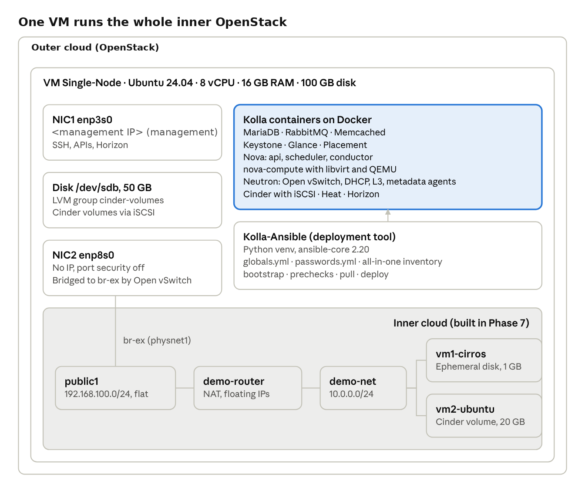
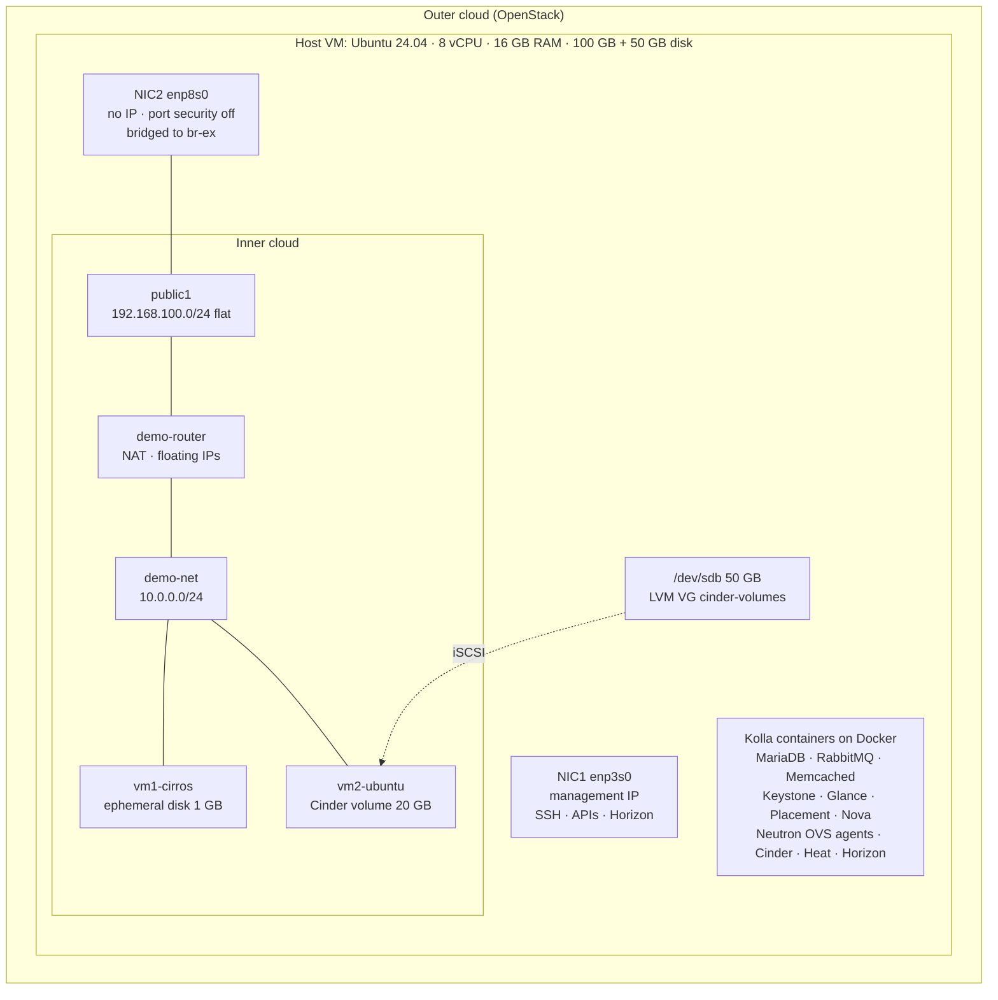
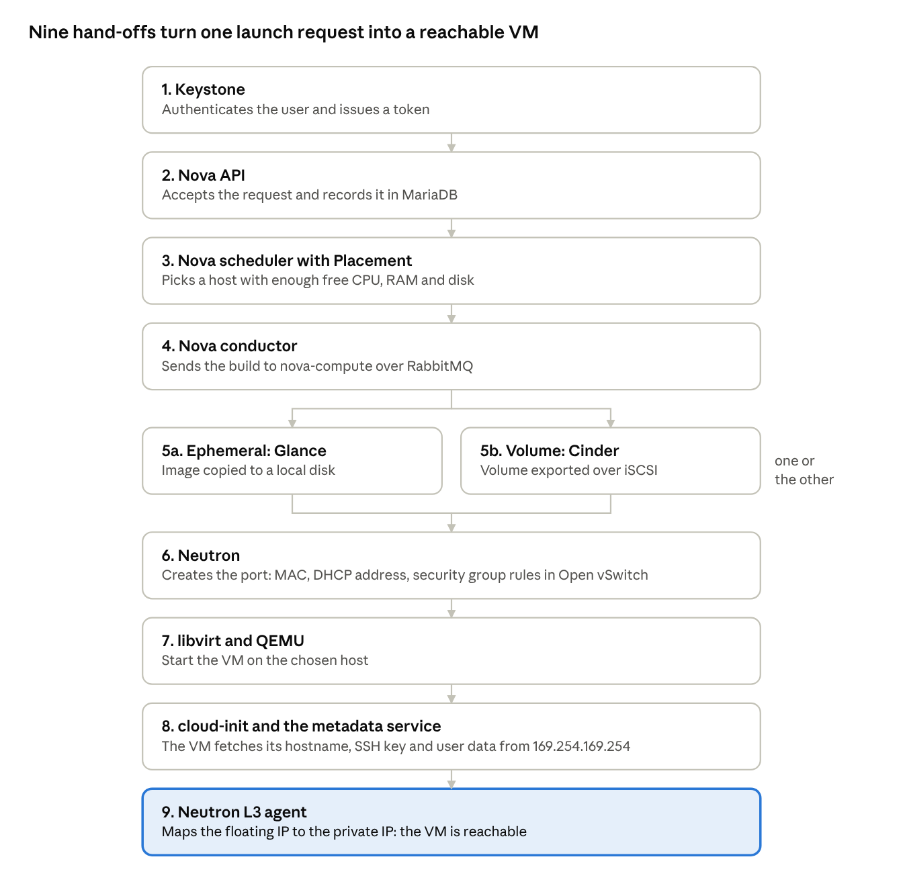

# OpenStack 2026.1 All-in-One Lab with Kolla-Ansible

A fully working single-node OpenStack cloud (release **2026.1**) deployed with **Kolla-Ansible**, running nested inside a VM on an OpenStack cloud. Every OpenStack service runs as a Docker container. The deployment was validated end to end by launching two VMs that demonstrate both storage models: an **ephemeral disk** and a persistent **Cinder volume**.

    

> **In 30 seconds:** I built a working OpenStack 2026.1 cloud from scratch with Kolla-Ansible: containerized services, Neutron networking with floating IPs, and Cinder block storage on LVM. I validated it with VMs on both ephemeral and persistent storage, and debugged real infrastructure problems along the way, including an upstream outage, a blocked repository and a ProxySQL/MariaDB port conflict.

---

## Highlights

- Deployed **Keystone, Glance, Nova, Placement, Neutron (Open vSwitch), Cinder (LVM + iSCSI), Heat and Horizon** with Kolla-Ansible (344 automated tasks, about 30 container images).
- Designed a **two-NIC host**: a management NIC, plus a Neutron external NIC with no IP and port security disabled on the outer cloud.
- Built **Cinder block storage** on a dedicated LVM volume group with thin provisioning.
- Created provider and tenant networks, a router with NAT and floating IPs, security groups and key pairs, **entirely from the CLI**.
- Launched **vm1-cirros** (ephemeral disk) and **vm2-ubuntu** (boot from a Cinder volume, configured by cloud-init); both reachable via floating IPs with ping and SSH.
- Diagnosed and fixed **7 real-world issues**, including an Ansible Galaxy outage, a blocked Docker repository and a ProxySQL/MariaDB port conflict. See [docs/troubleshooting.md](docs/troubleshooting.md).

## Skills demonstrated

`OpenStack` · `Kolla-Ansible` · `Ansible` · `Docker` · `Linux (Ubuntu)` · `Neutron / Open vSwitch` · `Cinder / LVM / iSCSI` · `QEMU / libvirt` · `cloud-init` · `netplan` · `Bash scripting` · `Troubleshooting`

---

## Architecture



NIC1 carries management traffic, NIC2 is bridged into the inner cloud's external network, and the second disk backs every Cinder volume.

<details>
<summary>Text version (Mermaid diagram)</summary>



</details>

## What happens when a VM is launched



vm1-cirros took branch **5a** (ephemeral disk from a Glance image) and vm2-ubuntu took branch **5b** (Cinder volume over iSCSI); every other step was the same for both.

---

## Tech stack

| Layer | Technology |
|---|---|
| Cloud platform | OpenStack 2026.1: Keystone, Nova, Placement, Neutron, Glance, Cinder, Heat, Horizon |
| Deployment | Kolla-Ansible 22.x, ansible-core 2.20, Python venv |
| Containers | Docker 29 (Ubuntu docker.io package) |
| Hypervisor | libvirt + QEMU (software emulation; no nested KVM) |
| Networking | Open vSwitch, flat provider network, VXLAN tenant network, L3 agent NAT |
| Storage | Cinder LVM backend (thin pool) over iSCSI; Nova ephemeral disks |
| Guest config | cloud-init, metadata service |
| Host OS | Ubuntu 24.04 LTS, netplan, systemd |

## Repository layout

| Path | Contents |
|---|---|
| [docs/deployment-guide.md](docs/deployment-guide.md) | Step-by-step deployment, phase by phase |
| [docs/troubleshooting.md](docs/troubleshooting.md) | Issues hit, diagnosis and fixes |
| [docs/lab-vs-production.md](docs/lab-vs-production.md) | What changes for a production design |
| [config/](config/) | Sanitized `globals.yml`, netplan and cloud-init examples |
| [scripts/](scripts/) | Pre-flight checks, collections install, Cinder LVM setup, cloud resources, demo VMs, verification |
| [screenshots/](screenshots/) | Horizon, network topology and CLI output |

## Quick start

```bash
# 1. Prepare the host (2 NICs, NIC2 without IP) -- see docs/deployment-guide.md, Phase 0
# 2. Install Kolla-Ansible
python3 -m venv ~/kolla-venv && source ~/kolla-venv/bin/activate
pip install -U pip
pip install git+https://opendev.org/openstack/kolla-ansible@stable/2026.1

# 3. Configure
sudo mkdir -p /etc/kolla && sudo chown $USER:$USER /etc/kolla
cp -r ~/kolla-venv/share/kolla-ansible/etc_examples/kolla/* /etc/kolla/
cp ~/kolla-venv/share/kolla-ansible/ansible/inventory/all-in-one ~/
kolla-ansible install-deps        # or scripts/01-install-collections-from-git.sh
kolla-genpwd
cat config/globals.yml.example >> /etc/kolla/globals.yml   # then edit placeholders

# 4. Deploy
MGMT_IP=<your-ip> ./scripts/00-preflight-check.sh
kolla-ansible bootstrap-servers -i ~/all-in-one
kolla-ansible prechecks -i ~/all-in-one --use-test-images
kolla-ansible pull -i ~/all-in-one
kolla-ansible deploy -i ~/all-in-one
kolla-ansible post-deploy -i ~/all-in-one

# 5. Build the cloud and launch the demo VMs
./scripts/03-create-cloud-resources.sh
./scripts/04-launch-demo-vms.sh
./scripts/05-verify.sh
```

## Validation results

| Check | Result |
|---|---|
| Kolla-Ansible deploy | `ok=344 changed=200 failed=0` |
| Nova services (scheduler, conductor, compute) | all `up` |
| Neutron agents (OVS, DHCP, L3, metadata) | all alive |
| Cinder services (scheduler, volume@lvm-1) | all `up` |
| vm1-cirros (ephemeral) | ACTIVE · floating IP · ping + SSH OK · 1 GB root disk |
| vm2-ubuntu (Cinder volume) | ACTIVE · booted in 158 s · floating IP · ping + SSH OK · 20 GB volume as `/dev/vda` |

## What I learned

- How OpenStack services cooperate on a VM launch: Keystone, Nova API, scheduler + Placement, conductor over RabbitMQ, Glance or Cinder, Neutron, libvirt/QEMU, metadata + cloud-init, L3 floating IPs.
- Why a nested OpenStack needs a second NIC with **port security disabled**.
- The difference between **ephemeral** and **persistent** VM storage, and how Cinder carves LVM volumes and exports them over iSCSI.
- A repeatable troubleshooting method: status, logs, ports, config, fix.

## Disclaimer

This is a **lab** deployment: single node, plain HTTP, public test images. It is not hardened for production. See [docs/lab-vs-production.md](docs/lab-vs-production.md). IP addresses and credentials in this repository are placeholders.

---

**Author:** Ishaan Arora · Cloud Support Engineer · [LinkedIn](https://www.linkedin.com/in/ishaan-a-713491184)
